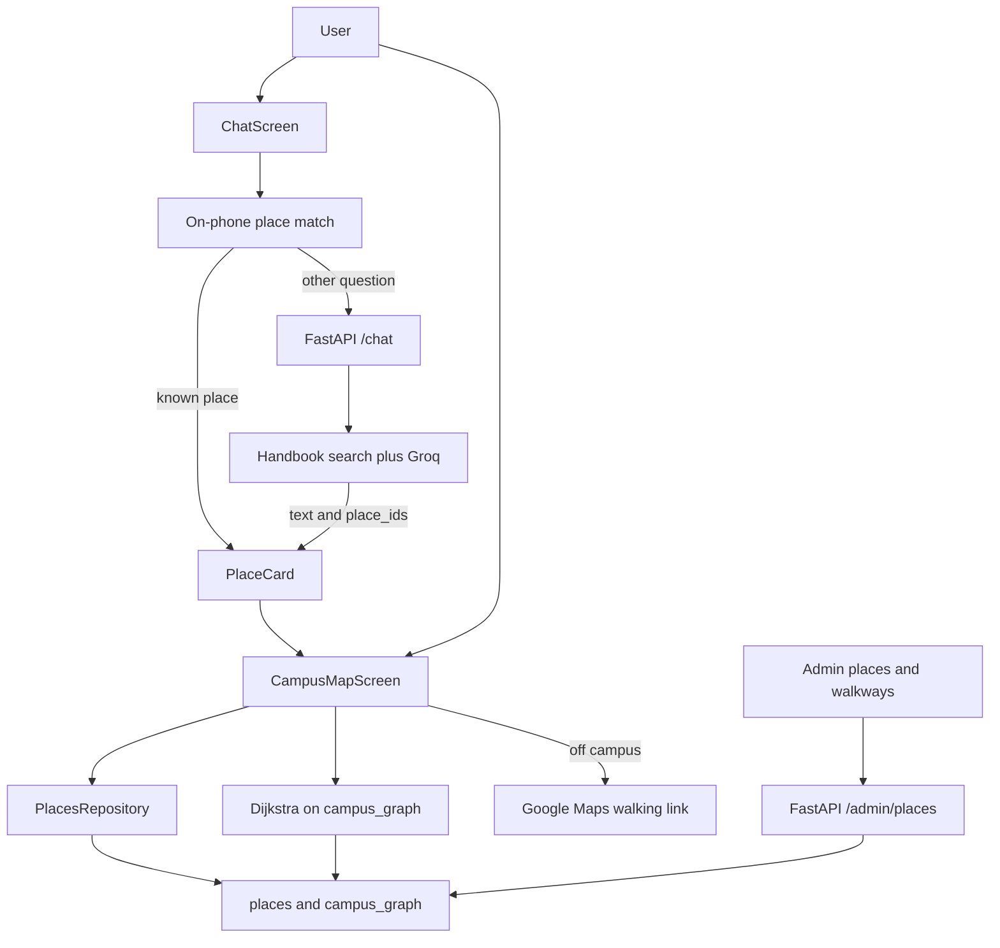

# Campus navigation evaluation

## Architecture

The phone answers "where is the cafe" from the place list. It never asks the model to invent a coordinate. Open questions still go to the handbook. If a retrieved rule is tagged with a place, the reply can include that place card.

## Demo script

1. Open Campus Map. Search "cafe", tap LGU Cafe, and show the place sheet.
2. Tap Directions while standing inside the campus polygon. Show the step banner, the route line, and End.
3. Ask the chat "where is the library?". The card appears without waiting for the model. Tap Show on map.
4. Ask "where can I eat lunch?". The text answer comes from the handbook, and the cafe card comes from the place tag.
5. Ask "who won the cricket world cup?". The bot refuses. No place card.
6. Zoom into Block B, switch to First, and show Classroom B-104. Scan or show the entrance QR.
7. As admin, add a place by dropping the pin. It appears on the map after save.

## Chatbot checks

| # | Input | Path | Expected |
|---|---|---|---|
| 1 | LGU | router | LGU Main Campus card |
| 2 | where is LGU cafe | router | LGU Cafe card, because the longer name wins |
| 3 | where is fountain ground | router | Fountain Ground card |
| 4 | navigate to canteen | router | LGU Cafe card through the canteen alias |
| 5 | where can I eat lunch? | RAG | Text answer plus the cafe card from the place tag |
| 6 | when does the library open? | RAG | Library hours. Not treated as a directions request |
| 7 | who won the cricket world cup? | RAG | Polite refusal, no place card |
| 8 | library kahan hai | router | Central Library card |
| 9 | Directions on campus | map | In-app route, time left, arrival card |
| 10 | Directions off campus | map | Google Maps opens toward the nearest gate |
| 11 | Location denied | map | Banner, then the "I'm at" list when directions start |

Checks 1 to 4 and 6 to 8 are covered by `aicc/test/place_search_test.dart` and `aicc/test/navigation_intent_test.dart`. Check 5 is covered by `aicc-data-service/tests/test_place_links.py`.

## Field walk log

Coordinates in the seed are a sketch of LGU DHA Phase 6. Replace them with right-click Google Maps points before judging GPS error. Fill Actual and GPS error on campus.

| Route | Expected | Actual | GPS error (m) |
|---|---|---|---|
| Main Gate to LGU Cafe | South walk, then west to the cafe | | |
| Main Gate to Central Library | South, central, west, then library | | |
| Main Gate to Fountain Ground | South, central, then fountain | | |
| Main Gate to Classroom B-104 | Outdoor path to Block B, then stairs or lift to the first floor | | |
| Off campus, any place | Google Maps opens to the nearest gate | | |

## Viva answers

**Why a place list in front of the model?** Directions need an exact pin. A keyword match is instant, free, and does not guess. The model is used only for open questions.

**Why not fine-tune?** Updating a place or a rule is a data change. Fine-tuning would bake the facts into the model and cost more.

**How does a knowledge answer stay grounded?** The question is matched to handbook chunks. The reply text is the handbook line. A place card is attached only when that chunk, or a food question, already has a place id.

**What if the place is not in the list?** The question falls through to the handbook. A new place is added in the admin screen and shows up without an app update.

**Why our own paths inside campus?** Google Maps does not know the internal walkways. Dijkstra runs on our nodes and edges. Outside the campus outline, the app hands off to Google Maps.

**Why does indoor positioning use a QR code?** GPS is unreliable inside. A code at the door or the stairs sets the start node. The same router then continues upstairs. Stairs can be avoided by taking the lift edge.

**Is the key safe?** The Groq key stays in the server environment. The app never sees it.

**What is still limited?** The floor pictures are a Block B sketch until ODA File Converter is installed and the university allows the architect drawings. Place coordinates still need a campus survey. English and Roman Urdu are supported for place names. Live bus tracking is out of scope.
